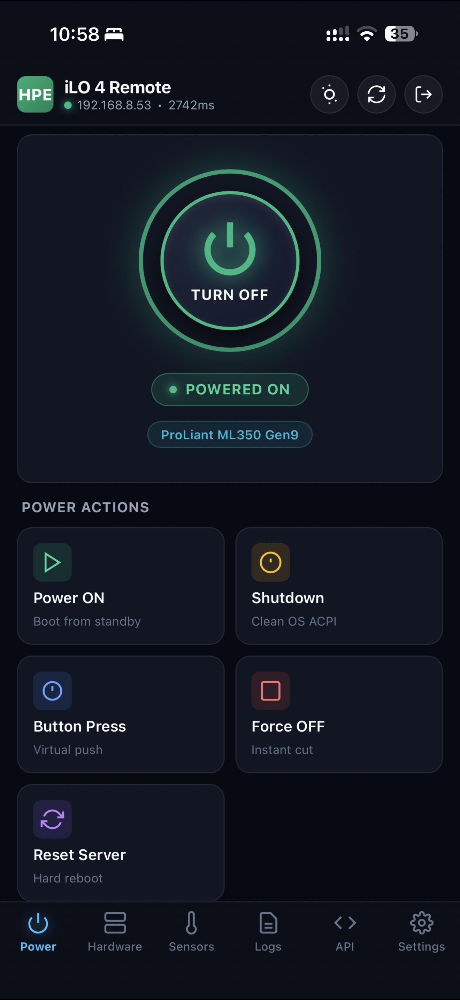
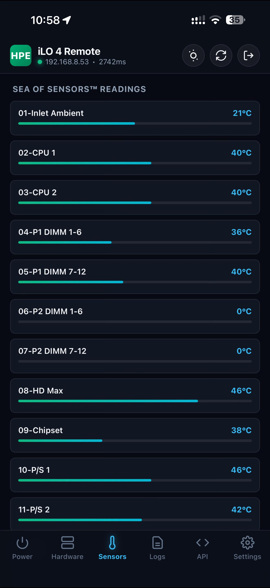
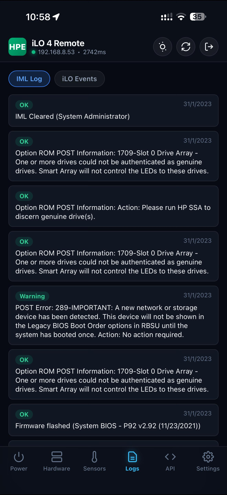
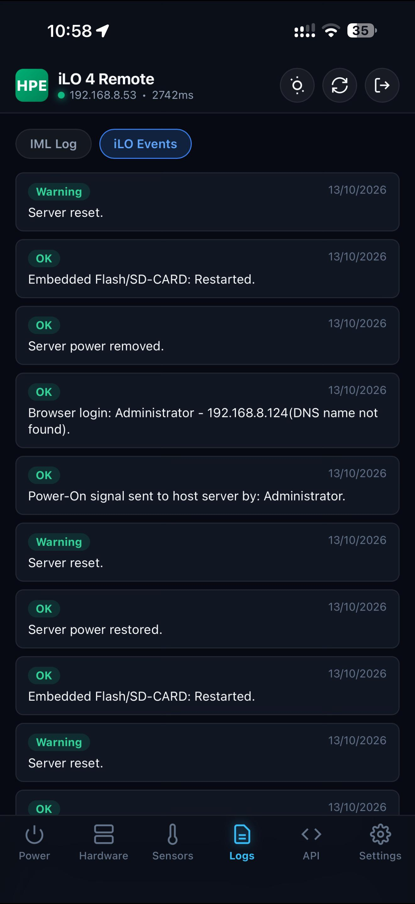
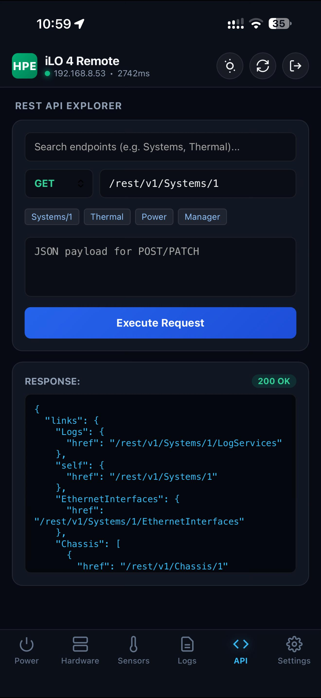
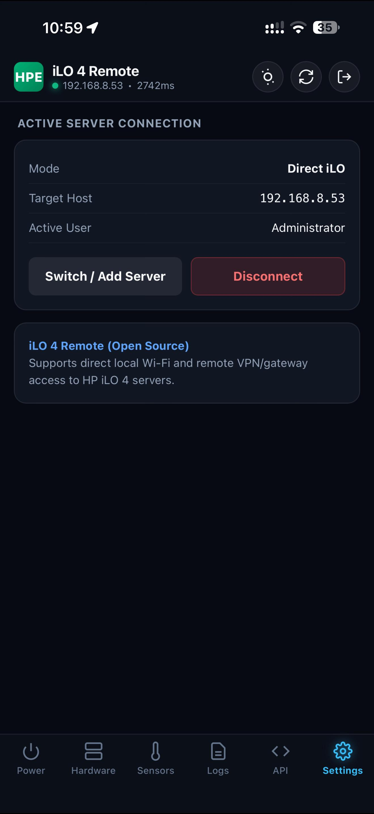

# ilo4-remote

A lightweight, native mobile app (Android APK and sideloadable iOS IPA) for managing HP iLO 4 servers directly over your local network or VPN.

---

### Background

I run an HP ProLiant ML350 Gen9 tower in my home setup. Like many people who keep Gen8 and Gen9 hardware around for homelabs or small production workloads, these servers are reliable, quiet workhorses with plenty of compute and RAM.

The problem has always been remote management on mobile. The official "HP iLO Mobile" app on both iOS and Android hasn't been properly maintained in years. On modern phones, you type in your host, username, and password, tap connect, and literally nothing happens—it either hangs on a black screen or silently fails due to outdated TLS and networking stacks in the old app bundle.

HP's web interface works fine on a desktop browser, but it's miserable to navigate on a phone when you just want to power on a box from the couch, check temperatures after a heavy job, or see why a fan suddenly ramped up.

I wrote this project to solve that annoyance. It talks directly to the iLO 4 RESTful API (`/rest/v1`), requires no web servers, no background daemons, and no cloud accounts, and runs cleanly on both Android and iOS.

---

### Live Demo (iPhone running iOS)

Here is the app running live on iPhone connected to an HP ProLiant ML350 Gen9 over local Wi-Fi:

| Power & Server Status | Sea of Sensors (46 Points) | Integrated Management Log |
| :---: | :---: | :---: |
|  |  |  |

| iLO Event Log | REST API Explorer | Server Settings & Auto-Connect |
| :---: | :---: | :---: |
|  |  |  |

---

### Features

- **Direct HTTPS Connection**: Connects straight to iLO 4 (`https://<ilo-ip>/rest/v1/`) without any proxy, gateway, or python service. Handles iLO's default self-signed SSL certificates safely at the native OS layer.
- **Persistent Credentials & Auto-Connect**: Uses native OS storage (`NSUserDefaults` on iOS, `SharedPreferences` on Android via `@capacitor/preferences`) to remember your server details across phone restarts and updates. Toggle "Auto-connect on launch" to jump straight into your dashboard when you open the app.
- **Power Control**: Check live power state, turn on, graceful ACPI shutdown, momentary button press, cold boot, and force off.
- **UID LED**: Toggle the chassis blue beacon light.
- **Thermal & Fans**: Reads all 46 Sea of Sensors temperature points (CPUs, DIMMs, system board, HD Max) and displays duty cycles for all cooling fans.
- **Hardware Telemetry**: Health rollup, dual CPU details, installed memory, and power supply status.
- **Event Logs**: View Integrated Management Log (IML) and iLO Event Log (IEL) entries with timestamps and severity tags.
- **REST Explorer**: Built-in requester to query any of the 120+ iLO 4 endpoints directly and inspect JSON responses.
- **Multi-Server Support**: Save multiple profiles (e.g., lab server, backup box) and switch between them seamlessly.

---

### Downloads

Pre-built binaries from the GitHub Actions build pipeline:

- **Android (APK)**: [ilo4-remote-v1.0.5.apk](https://github.com/brownfury/ilo4-remote/releases/download/v1.0.5/ilo4-remote-v1.0.5.apk) (~3.6 MB)
- **iOS (Sideloadable IPA)**: [ilo4-remote-v1.0.5.ipa](https://github.com/brownfury/ilo4-remote/releases/download/v1.0.5/ilo4-remote-v1.0.5.ipa) (~800 KB)

Source releases and checksums are on the [Releases page](https://github.com/brownfury/ilo4-remote/releases).

---

### Installation

#### Android
1. Download the `.apk` on your phone.
2. Open the file and allow installation from your browser or file manager if prompted.
3. Open the app, enter your iLO IP address (e.g. `192.168.1.50`), username, and password.

#### iOS
Because iOS does not support loose sideloading out of the box without signing, use your preferred tool:

- **AltStore / SideStore**: Download the `.ipa` on device, tap "+", and install.
- **Sideloadly**: Connect via USB, drag the `.ipa` onto Sideloadly, provide your Apple ID for ad-hoc signing, and click Start.
- **TrollStore**: Directly open and install if on a supported iOS version.
- **Xcode**: Open `mobile/ios/App/App.xcworkspace`, select your connected device, pick your free personal team under Signing, and hit Run (`Cmd+R`).

---

### Building from source

#### Prerequisites
- Node.js 18+
- JDK 17
- Android SDK (command-line tools or Android Studio)
- Xcode (if building for iOS locally on macOS)

#### Build commands

```bash
cd mobile
npm install
npx cap sync

# Build Android debug APK:
cd android
./gradlew assembleDebug
# Output binary: android/app/build/outputs/apk/debug/app-debug.apk

# Build iOS project:
cd ../ios/App
open App.xcworkspace
```

Automated builds for both platforms are defined in `.github/workflows/build-and-release.yml`. Pushing a tag (`git tag vX.Y.Z && git push origin vX.Y.Z`) compiles both targets in GitHub Actions.

---

### Security & Privacy

All credentials and server addresses are stored strictly on-device in native protected storage (`NSUserDefaults` / `SharedPreferences`). The app never contacts any cloud servers, telemetry endpoints, or third-party APIs. All network traffic is strictly between your phone and your server's iLO IP.

---

### License

MIT. Free to use, modify, and distribute.
